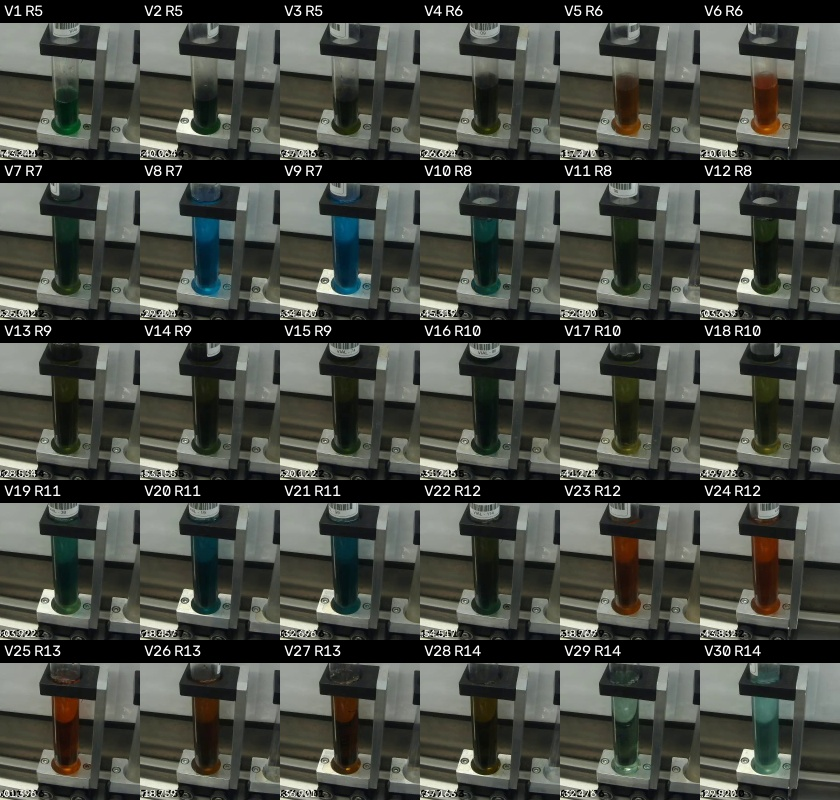

# VialSense: Liquid Finder

Finds the vial and the liquid in each camera frame of the fluid mixing station, then measures the liquid's color. No fixed box and no hand-picked frames.

Built by Salah Alrayess for the Rockwell Automation and NVIDIA Physical AI Hackathon, Fall 2026 (Dataset 2: Fluid Mixing Station 3).


Yellow box: vial holder found. Red box: area measured for color.

## Where this fits

```
camera frame -> Liquid Finder (this repo) -> liquid color -> Anomaly check (Eduardo) -> operator alert
```

The Liquid Finder answers two questions: where is the liquid, and what color is it. Eduardo's anomaly check answers the next one: is that color right for the recipe.

## How it works

1. **Find the vial.** Each vial sits in a black holder block. The finder keeps wide, short dark shapes and picks the one closest to the fill nozzle.
2. **Check the position.** A block off the fill position, sideways or up, means the vial is moving or tilted. The frame is skipped.
3. **Find the liquid.** The finder scans the tube under the block row by row from the bottom. A row counts as liquid when most of its pixels are colorful or dark. Empty glass shows the gray conveyor behind it, which is neither.
4. **Measure.** It averages the middle of the liquid column and skips the falling stream at the top, the holder base at the bottom, and glare.
5. **Rate confidence.** Each reading is `high`, or `low` with a reason: pale liquid that looks like an empty tube, or a column too short to trust.

The output uses the same column names as Eduardo's color analysis (`r_mean`, `g_mean`, `b_mean`, `h_mean_opencv`, `s_mean_opencv`, `v_mean_opencv`), so his code reads it directly.

## Results

| Video | Labels | Frames checked | Vial found at fill position | Liquid found |
|---:|---|---:|---:|---:|
| 5 | yes | 1,130 | 1,070 of 1,070 fill frames | 1,024 |
| 1 | no | 1,123 | 1,110 | 693 |
| 2 | no | 161 | 154 | 85 |
| 3 | no | 194 | 190 | 104 |
| 4 | no | 317 | 312 | 210 |

- On video 5, all 184 end-of-fill readings rate `high`.
- Vial 7 measures green and Vials 8 and 9 measure blue. This matches the organizers' carryover example: Recipe 7 is blue, and leftover orange from Recipe 6 turns its first vial green.
- Videos 1 to 4 were held back as a check. They exposed two problems that video 5 did not show, pale liquid and a tilted vial in motion. Both are now handled.
- Runs in about 2 ms per frame on a CPU. No GPU needed.
- No model was trained on real images, following the challenge rules.

## Label fix for Dataset 2

The organizers' still-image label file (`video5_frame_labels.csv`) uses a different clock from the video. Video time runs at 0.8225 of still time, so the error grows to about 5 minutes by the end. Of 509 stills labeled as "in fill", only 26 carry the right vial.

The video and its fill windows share one clock, so this project takes its frames straight from the video. `sync_labels.py` also writes a corrected still-image label file to `color_check/labels_corrected/`.



## Setup

Python 3.12 is recommended. From the `color_check` folder:

```
python -m venv .venv
.venv\Scripts\activate            (Windows)
source .venv/bin/activate         (macOS / Linux)
python -m pip install -r requirements.txt
```

Download the Dataset 2 vial_fill data from the [challenge page](https://msoe-maic.com/library/?article=Rockwell-NVIDIA-Fall-2026-Fluid-Mixing) and extract it so this path exists:

```
color_check/data/raw/dataset2/vial_fill/videos/vial_fill_video_5.mp4
```

Then set the import path:

```
set PYTHONPATH=src                (Windows)
export PYTHONPATH=src             (macOS / Linux)
```

## Usage

Check one frame (photo, video moment, or live camera):

```
python -m vialsense.find_color --image frame.jpg
python -m vialsense.find_color --video data/raw/dataset2/vial_fill/videos/vial_fill_video_5.mp4 --time 307 --save-preview preview.jpg
python -m vialsense.find_color --camera 0
```

Each reading prints one JSON line:

```
{"found_vial": true, "found_liquid": true, "liquid_height_px": 127,
 "r_mean": 14.68, "g_mean": 28.14, "b_mean": 22.4, "confidence": "high", ...}
```

Measure all 30 labeled vials in video 5:

```
python -m vialsense.extract_video_frames
python -m vialsense.measure_frames
```

Scan any video, labeled or not:

```
python -m vialsense.scan_video --video data/raw/dataset2/vial_fill/videos/vial_fill_video_1.mp4
```

Run the tests:

```
python -m pytest tests
```

## Use from Python

```python
import cv2
from vialsense.liquid_finder import find_liquid

frame = cv2.imread("frame.jpg")          # or a frame from cv2.VideoCapture
result = find_liquid(frame)
if result.found_liquid and result.confidence == "high":
    print(result.r_mean, result.g_mean, result.b_mean)
```

## Files

| File | What it does |
|---|---|
| `src/vialsense/liquid_finder.py` | Finds the vial and liquid, measures color, rates confidence |
| `src/vialsense/find_color.py` | One frame in, color out. Photo, video, or live camera |
| `src/vialsense/scan_video.py` | Runs the finder over a whole video, saves readings and a review sheet |
| `src/vialsense/extract_video_frames.py` | Pulls correctly labeled frames for all 30 vials from video 5 |
| `src/vialsense/measure_frames.py` | Measures every extracted frame and the finished color per vial |
| `src/vialsense/sync_labels.py` | Fixes the still-image label clock drift |
| `src/vialsense/colorcheck.py` | Color math: LAB conversion and CIEDE2000 color difference |
| `tests/` | 18 tests for the color math and the finder |
| `results/liquid_finder/` | Readings, per-vial colors, and review sheets for videos 1 to 5 |

More detail: [LIQUID_FINDER.md](color_check/LIQUID_FINDER.md).

## Limits

- Pale, mostly clear liquid looks like an empty tube in this camera. These readings are marked `low`. Next step: compare each vial to its own frame from before the fill.
- Tuned for the current camera position. A moved camera needs new position limits at the top of `liquid_finder.py`.
- Reads the vial at the fill position only. The second lane is ignored.
- Tested on the five Dataset 2 videos. Not yet tested on digital twin renders.
