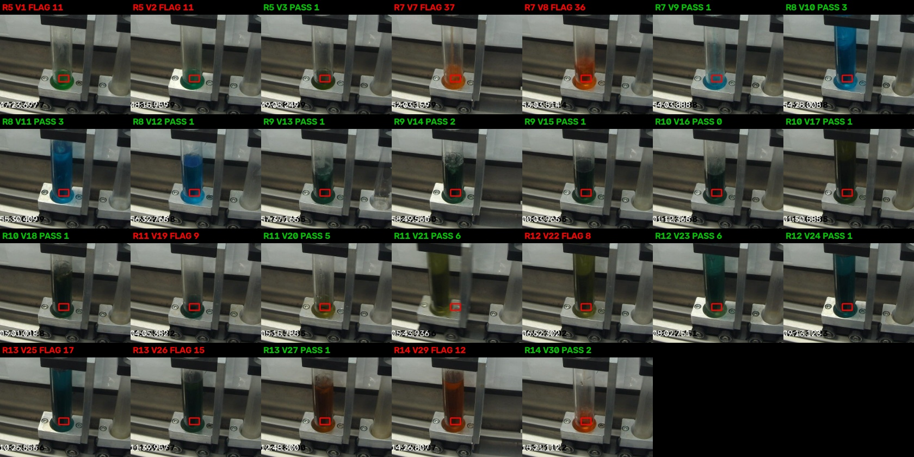

# VialSense color check (PASS / FLAG)

Owner: Salah. Builds on Eduardo's color measurements in this repo.

> **Results below are out of date.** The original still-image labels
> (`video5_frame_labels.csv`) use the wrong clock. 229 of the 271 measured
> stills belong to a different vial than labeled. See
> [Label sync fix](#label-sync-fix). The code is fine. The results need a rerun
> on corrected labels.

## Label sync fix

The video and the vial fill windows share one clock. The stills use another.
Video time = 0.8225 x still time, so the error grows to about 5 minutes by the
end. Stills only cover video 0 to 1396 s, so Vials 26 to 30 have no in-fill
stills at all.

- `sync_labels.py` matches every still to its video frame and writes
  `labels_corrected/video5_frame_labels_corrected.csv`.
- `extract_video_frames.py` pulls correctly labeled frames for all 30 vials
  straight from the video, one per second.
- `results/video5_end_of_fill_all_vials.jpg` shows the finished color of every
  vial. Each recipe matches its tank colors, and the first vial of most recipes
  shows carryover.

```bash
PYTHONPATH=src python -m vialsense.sync_labels --data data/raw/dataset2/vial_fill
PYTHONPATH=src python -m vialsense.extract_video_frames --data data/raw/dataset2/vial_fill
```

This module answers one question for each vial photo: **does the liquid color
match the recipe?** It returns PASS or FLAG, a score, and a carryover hint.



## How it works

1. **Measure.** Average the liquid pixels inside the box (ROI), skipping glare
   and black pixels. (`colorcheck.measure_liquid`)
2. **Convert to LAB.** LAB matches how people see color differences.
   (`colorcheck.rgb_to_lab`)
3. **Score.** CIEDE2000 Delta E between the seen color and the recipe's expected
   color. Brightness counts half (kL = 2), since lighting and liquid depth shift
   brightness more than hue. (`colorcheck.delta_e_2000`)
4. **Decide.** Score at or under 8: PASS. Over 8: FLAG.
5. **Carryover hint.** When a vial is flagged and its color sits closer to the
   previous recipe than to its own, the note says "possible carryover".

## Expected colors

`references/recipe_colors.csv` holds one expected color per recipe. The rule:
the **last vial** of each recipe is the reference, since carryover hits the
first vials after a switch and the last vial is the most flushed.

This is an assumption. Swap in known-good vials from the organizers once they
share them.

## Run it

From the repo root, after `pip install -r requirements.txt`:

```bash
# 1. Build expected colors from the saved measurements
PYTHONPATH=src python -m vialsense.build_references

# 2. Check one photo
PYTHONPATH=src python -m vialsense.check_vial \
  --image results/recipe_7/annotated_images/vial_fill_20260923_195155_106788.jpg \
  --recipe 7 --roi 307 387 325 397 --save-preview preview.jpg

# 3. Check every frame in Recipes 5-14
PYTHONPATH=src python -m vialsense.check_batch

# 4. Run the tests
PYTHONPATH=src python -m pytest tests
```

Windows PowerShell: run `$env:PYTHONPATH = "src"` first, then drop the
`PYTHONPATH=src` prefix.

The `--roi 307 387 325 397` box is Eduardo's box shrunk by 3 pixels, so the red
outline on his annotated photos is not counted. For raw photos, leave `--roi` off.

## Output for the team

`results/color_check/frame_checks.csv` has one row per frame: recipe, vial,
file, seen color, expected color, score, status, note. Yen's screen reads this.

`results/color_check/vial_summary.csv` has one row per vial with a majority verdict.

## Results on Dataset 2 (271 frames, 253 from photos)

| Recipe | Flagged vials | Carryover hint | What the photos show |
|---:|---|---|---|
| 5 | 1, 2 | no previous recipe in data | Darker green than vial 3 |
| 6 | 4, 5 | yes | Dark, close to Recipe 5 |
| 7 | 7, 8 | yes | Orange in a pale-blue recipe, matches Recipe 6 |
| 8 | none | | All blue |
| 9 | none | | |
| 10 | none | | Same color family as Recipe 9 |
| 11 | 19 | yes | Dark green, close to Recipe 10 |
| 12 | none (22 borderline at 7.9) | | |
| 13 | 25, 26 | yes | Teal in an orange recipe, matches Recipe 12 |
| 14 | 29 | yes | Darker orange than vial 30 |

Pattern: flagged vials are the **first vials after a recipe switch**, and most of
them look like the previous recipe. This matches the carryover problem.

## Limits

- References come from the same data the check runs on. No known-good runs or
  contamination labels exist yet. The threshold of 8 is a first guess tuned here.
- Recipe 7's reference uses one frame. Recipe 11's uses two, and the box sits
  partly off the liquid in those photos. Treat both as weak.
- Fixed box. When the vial moves, the box misses the liquid. Auto-locating the
  liquid is the next step.
- Recipes with similar colors (9 and 10) hide carryover from a color check.

## Next steps

1. Auto-find the liquid so the box follows the vial.
2. Get known-good reference vials from the organizers.
3. Hand `frame_checks.csv` to Yen and the `check_vial` function to Lorena.
