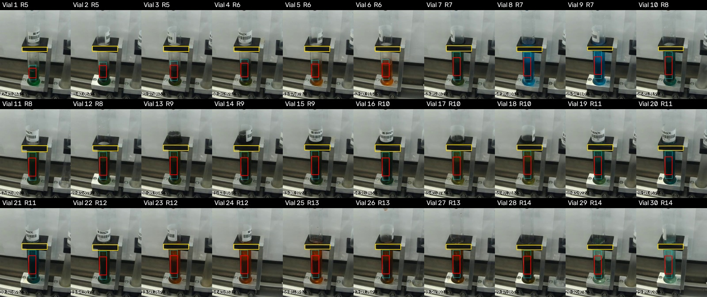

# Liquid finder (Salah)

Finds the vial and the liquid in a vial_fill camera frame, then measures the
liquid's color. Output uses Eduardo's column names (`r_mean`, `g_mean`,
`b_mean`, `h_mean_opencv`, `s_mean_opencv`, `v_mean_opencv`), so his anomaly
code reads it directly.

```
frame -> find vial -> find liquid -> measure color -> Eduardo's anomaly check
```



## How it works

1. **Find the vial.** Each vial sits in a black holder block. The finder keeps
   wide, short dark shapes (100 to 150 px wide) and picks the one closest to
   the nozzle.
2. **Check the position.** If the block sits off the fill position, sideways or
   up, the vial is moving or tilted. The frame is skipped.
3. **Find the liquid.** Scan the tube under the block row by row from the
   bottom. A row counts as liquid when most of its pixels are colorful or dark.
   The liquid is the run of such rows touching the bottom.
4. **Measure.** Average the middle of the column. Skip the top 20% (falling
   stream, surface) and the bottom 15% (holder base), and skip glare.
5. **Rate confidence.** `high`, or `low` with a note:
   - `pale liquid`: bright yellowish gray, looks like an empty tube. The color
     is the liquid's, but the liquid level is too low.
   - `short column`: fewer than 15 px of liquid, mostly the tube bottom.

## Results

| Video | Labels | Frames | Vial at fill position | Liquid found | High | Low |
|---:|---|---:|---:|---:|---:|---:|
| 5 | yes | 1,130 | 1,070 of 1,070 fill frames | 1,024 | 926 | 98 |
| 1 | no | 1,123 | 1,110 | 693 | 595 | 98 |
| 2 | no | 161 | 154 | 85 | 79 | 6 |
| 3 | no | 194 | 190 | 104 | 30 | 74 |
| 4 | no | 317 | 312 | 210 | 171 | 39 |

Video 5 checks:
- All 184 end-of-fill readings rate `high`.
- Vial 7 measures green and Vials 8 and 9 blue, as the organizers describe.
- Each recipe's last vial matches its tank colors.

Videos 1 to 4 have no labels, so they are checked by eye with the review sheets
in `results/liquid_finder/scan_vial_fill_video_N/`. Video 3 has many `low`
readings because it runs mostly clear, pale liquids.

## How it was tuned

Limits (darkness cutoff, block size, position range) were set by looking at
video 5. Videos 1 to 4 were the hold-out check: they exposed two failures that
video 5 did not show (pale liquid, a tilted vial in motion), and both are now
handled. No model was trained on real images, as the challenge rules ask.

## Commands

From the repo root, with `PYTHONPATH=src` set (`set PYTHONPATH=src` on Windows):

```bash
# One frame (photo, video moment, or live camera)
python -m vialsense.find_color --image frame.jpg
python -m vialsense.find_color --video data/raw/dataset2/vial_fill/videos/vial_fill_video_5.mp4 --time 309 --save-preview preview.jpg
python -m vialsense.find_color --camera 0

# Whole labeled video 5: extract frames, then measure
python -m vialsense.extract_video_frames
python -m vialsense.measure_frames

# Any video, labeled or not
python -m vialsense.scan_video --video data/raw/dataset2/vial_fill/videos/vial_fill_video_1.mp4

# Tests
python -m pytest tests
```

## For Lorena: live integration

```python
import cv2
from vialsense.liquid_finder import find_liquid

cap = cv2.VideoCapture(0)            # camera index or stream URL
ok, frame = cap.read()
result = find_liquid(frame)
if result.found_liquid and result.confidence == "high":
    color = (result.r_mean, result.g_mean, result.b_mean)
    # pass color and the current recipe to Eduardo's anomaly check
```

`find_liquid` takes one 640x480 BGR frame and runs in about 2 milliseconds on a CPU.

## Limits

- Pale, mostly clear liquid looks like an empty tube in this camera. Those
  readings are flagged `low`. A fix: compare against the same vial's frame
  from before the fill started.
- Tuned for the current camera position. A moved camera needs the position
  limits at the top of `liquid_finder.py` updated.
- Reads one vial at the fill position. The second lane is ignored.
